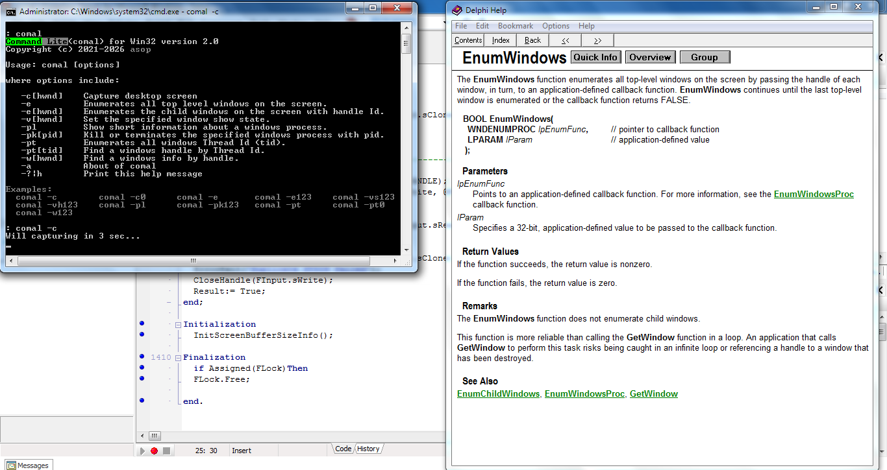

# 🚀 Comal


*Command Lite(comal) for Win32 version 2.0*
*Copyright (c) 2021-2026 asop*

<p align="center">
  
</p>

```
Usage: comal [options]

where options include:

   -c[hwnd]    Capture desktop screen
   -e          Enumerates all top level windows on the screen.
   -e[hwnd]    Enumerates the child windows on the screen with handle Id.
   -v[hwnd]    Set the specified window show state.
   -pl         Show short information about a windows process.
   -pk[pid]    Kill or terminates the specified windows process with pid.
   -pt         Enumerates all windows Thread Id (tid).
   -pt[tid]    Find a windows handle by Thread Id.
   -w[hwnd]    Find a windows info by handle.
   -a          About of comal
   -?|h        Print this help message

Examples:
  comal -c        comal -c0      comal -e       comal -e123    comal -vs123
  comal -vh123    comal -pl      comal -pk123   comal -pt      comal -pt0
  comal -w123
```
